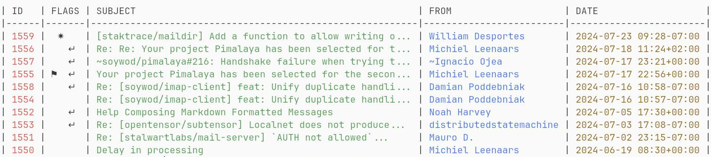

<div align="center">
  
  <h1>📫 Himalaya</h1>
  <p>CLI to manage emails</p>
  <p>
    <a href="https://matrix.to/#/#pimalaya:matrix.org"></a>
    <a href="https://fosstodon.org/@pimalaya"></a>
    <a href="https://pimalaya.org/sponsor/"></a>
  </p>
</div>



## Table of contents

- [Features](#features)
- [Installation](#installation)
- [Configuration](#configuration)
  - [Proton Mail](#proton-mail)
  - [Fastmail](#fastmail)
  - [Gmail](#gmail)
  - [Outlook](#outlook)
  - [Posteo](#posteo)
  - [iCloud Mail](#icloud-mail)
- [Usage](#usage)
- [Interfaces](#interfaces)
- [FAQ](#faq)
- [AI policy](https://github.com/pimalaya/.github/blob/master/AI_POLICY.md)
- [License](#license)
- [Social](#social)
- [Contributing](./CONTRIBUTING.md)
- [Sponsoring](#sponsoring)

## Features

- **Shared API** for `mailboxes`, `envelopes`, `flags`, `messages` and `attachments`
- **Protocol-specific APIs** exposing each backend's full surface
- **IMAP**, **SMTP**, **ManageSieve**, **JMAP**, **Gmail** (REST API), **Microsoft Graph** (Outlook / Microsoft 365) support
- **Maildir** <sup>[specs](https://cr.yp.to/proto/maildir.html)</sup>, **m2dir** <sup>[specs](https://man.sr.ht/~bitfehler/m2dir/)</sup>, **mbox** <sup>[specs](https://manpages.debian.org/bookworm/mutt/mbox.5.en.html)</sup>, **pimdir** <sup>[specs](https://github.com/pimalaya/pimdir)</sup> support
- **Simple auth** support for IMAP, SMTP and ManageSieve (anonymous, login, plain, oauthbearer, xoauth2, scram-sha-256)
- **HTTP auth** support for JMAP: basic, bearer
- **TLS** support:
  - [Rustls](https://crates.io/crates/rustls) with ring crypto
  - [Rustls](https://crates.io/crates/rustls) with aws crypto (requires `rustls-aws` feature)
  - [Native TLS](https://crates.io/crates/native-tls) (requires `native-tls` feature)
- **SOCKS5**, **HTTP** proxy support, per account or via `$ALL_PROXY` and `$HTTPS_PROXY`
- **TOML configuration** with multi-account support
- **Plain text** output: lists as aligned columns, records as `Label: value` lines, no border, no colour
- **JSON** output via `--json`
- **REPL** via `himalaya repl`, running commands over connections kept for the session
- **MCP server** via `himalaya mcp`, the shared API as tools, read-only by default

> [!TIP]
> Himalaya is written in [Rust](https://www.rust-lang.org/) and uses [cargo features](https://doc.rust-lang.org/cargo/reference/features.html) to gate backend support. The default feature set is declared in [Cargo.toml](./Cargo.toml).
>
> The default `vendored` feature builds SQLite from source; leave it out (`--no-default-features --features …`) to link the system one.

## Installation

### Pre-built binary

Himalaya can be installed with the installer:

*As root:*

```sh
curl -sSL https://raw.githubusercontent.com/pimalaya/himalaya/master/install.sh | sudo sh
```

*As a regular user:*

```sh
curl -sSL https://raw.githubusercontent.com/pimalaya/himalaya/master/install.sh | PREFIX=~/.local sh
```

These commands install the latest binary from the GitHub [releases](https://github.com/pimalaya/himalaya/releases) section.

For a more up-to-date version than the latest release, check out the [releases](https://github.com/pimalaya/himalaya/actions/workflows/releases.yml) GitHub workflow and look for the *Artifacts* section. These pre-built binaries are built from the `master` branch.

> [!NOTE]
> Such binaries are built with the default cargo features. If you need specific features, please use another installation method.

### Cargo

```sh
cargo install --locked --git https://github.com/pimalaya/himalaya.git
```

With only IMAP+SMTP support:

```sh
cargo install --locked --git https://github.com/pimalaya/himalaya.git \
  --no-default-features \
  --features imap,smtp,rustls-ring
```

### Arch Linux

From the community repository:

```sh
pacman -S himalaya
```

Or the [user repository](https://aur.archlinux.org/):

```sh
git clone https://aur.archlinux.org/himalaya-git.git
cd himalaya-git
makepkg -isc
```

Or with [yay](https://github.com/Jguer/yay):

```sh
yay -S himalaya-git
```

### Homebrew

```sh
brew install himalaya
```

> [!NOTE]
> Cargo features are not compatible with brew. If you need a different feature set, please use another installation method.

### Scoop

```sh
scoop install himalaya
```

### Fedora Linux/CentOS/RHEL

From the [COPR](https://copr.fedorainfracloud.org/coprs/atim/himalaya/) repo:

```sh
dnf copr enable atim/himalaya
dnf install himalaya
```

### Nix

If you have the [Flakes](https://nixos.wiki/wiki/Flakes) feature enabled:

```sh
nix profile install github:pimalaya/himalaya
```

Or run without installing:

```sh
nix run github:pimalaya/himalaya
```

### Sources

Requires [Rust](https://www.rust-lang.org/tools/install) 1.89 or later:

```sh
git clone https://github.com/pimalaya/himalaya
cd himalaya
cargo build --release --locked
```

The binary lands at target/release/himalaya.

## Configuration

Himalaya reads a TOML configuration you write, and never writes one. [config.sample.toml](./config.sample.toml) holds one account: the options every account shares with their values, then one commented section per backend or provider, yours to uncomment: IMAP and SMTP, ManageSieve, JMAP, Gmail, Microsoft Graph, Microsoft IMAP and SMTP, Fastmail, Maildir, m2dir, mbox and pimdir. The OAuth 2.0 sections read their token from [Ortie](https://github.com/pimalaya/ortie), whose sample has the matching sections. Releases and packages ship it as share/doc/himalaya/config.sample.toml.

Run without a configuration at a terminal, Himalaya welcomes you with the commands copying the shipped sample in place, or downloading it when none ships, then the first command to run. Under `--json` or in a script, it fails naming the path it looked at and the sample.

The `imap`, `smtp` and `sieve` blocks take one SASL mechanism, or none to skip authentication: `plain`, `login` and `scram-sha-256` with a `username` and a `password`, `oauthbearer` and `xoauth2` with a `username` and a `token`, `anonymous` with an optional `message`. `jmap.auth` takes `basic` (`username` and `password`), `bearer` (`token`) or `header`, a whole `Authorization` value. A secret is given as `raw` or as `command`, a shell string or an argument list printing it.

`display-name`, `signature`, `signature-delim`, `downloads-dir` and the `message`, `envelope` and `mailbox` options may also sit at the top level, before any table, as the fallback of every account not setting them: drop the sample's default lines from an account for the top level to apply.

A persistent configuration is loaded from every existing path among the following, each one deep-merged on top of the ones before, so $HOME/.himalayarc overrides the others (a path naming a file already loaded, such as a symlinked rc file, is skipped):

- $XDG_CONFIG_HOME/himalaya/config.toml
- $HOME/.config/himalaya/config.toml
- $HOME/.himalayarc

At most one account may be marked `default = true` across them: an rc file moving the default sets `default = false` on the account the other file marks.

These are the same paths the [himalaya-tui](https://github.com/pimalaya/himalaya-tui) TUI looks at: one TOML file backs both binaries. CLI-only fields and TUI-only sections coexist without errors.

Override those paths with `-c <PATH>`. Repeat it to merge several files, such as `-c public.toml -c private.toml`: the first one is the base and the next ones are deep-merged on top. Each `-c` takes one path, never split, and no environment variable is read.

To add an account, add an `[accounts.<name>]` table to your config file. `himalaya account list` and `himalaya account check` inspect and validate the accounts declared.

### Proton Mail

Proton does not expose IMAP/SMTP directly: run [Proton Bridge](https://proton.me/mail/bridge), which synchronizes mail locally and serves it on a local IMAP/SMTP endpoint. The password is the one generated by the Bridge, not your Proton account password.

```toml
[accounts.proton]

imap.server = "imap://127.0.0.1:1143"
imap.sasl.plain.username = "example@proton.me"
imap.sasl.plain.password.command = "pass show proton-bridge"

smtp.server = "smtp://127.0.0.1:1025"
smtp.sasl.plain.username = "example@proton.me"
smtp.sasl.plain.password.command = "pass show proton-bridge"
```

To keep TLS on the local link, export the certificate generated by the Bridge and enable STARTTLS:

```toml
imap.starttls = true
imap.tls.cert = "/path/to/exported/cert.pem"

smtp.starttls = true
smtp.tls.cert = "/path/to/exported/cert.pem"
```

### Fastmail

Fastmail needs an [app password](https://www.fastmail.help/hc/en-us/articles/360058752854) for IMAP/SMTP, or an [API token](https://www.fastmail.help/hc/en-us/articles/5254602856719) for its native JMAP endpoint.

```toml
[accounts.fastmail]

imap.server = "imaps://imap.fastmail.com"
imap.sasl.plain.username = "example@fastmail.com"
imap.sasl.plain.password.command = "pass show fastmail"

smtp.server = "smtps://smtp.fastmail.com"
smtp.sasl.plain.username = "example@fastmail.com"
smtp.sasl.plain.password.command = "pass show fastmail"
```

To use JMAP instead, replace the `imap`/`smtp` blocks with a single `jmap` one:

```toml
jmap.server = "https://api.fastmail.com/jmap/session"
jmap.auth.bearer.token.command = "pass show fastmail"
```

### Gmail

Gmail rejects the account password over SASL PLAIN: generate an [app password](https://myaccount.google.com/apppasswords) (requires 2-step verification) and feed it through `password.command` or `password.raw`.

```toml
[accounts.gmail]

imap.server = "imaps://imap.gmail.com:993"
imap.sasl.plain.username = "example@gmail.com"
imap.sasl.plain.password.command = "pass show gmail"

smtp.server = "smtps://smtp.gmail.com:465"
smtp.sasl.plain.username = "example@gmail.com"
smtp.sasl.plain.password.command = "pass show gmail"

mailbox.alias.inbox = "INBOX"
mailbox.alias.sent = "[Gmail]/Sent Mail"
mailbox.alias.drafts = "[Gmail]/Drafts"
mailbox.alias.trash = "[Gmail]/Trash"
mailbox.alias.archive = "[Gmail]/All Mail"
```

Every Gmail label shows up as a top-level IMAP mailbox, and the special ones live under the `[Gmail]/` prefix, so quote them in the shell or reach them through an alias.

`[Gmail]/All Mail` is the archive holding every message, so aliasing it puts "search everything" one flag away: `himalaya envelope search -m archive ...`.

To use Gmail's native REST API instead of IMAP/SMTP, replace the blocks above with a single OAuth 2.0 bearer token from a helper such as [ortie](https://github.com/pimalaya/ortie):

```toml
gmail.auth.token.command = ["ortie", "token", "show", "-a", "gmail"]
```

Labels become mailboxes here too, but they carry the API's opaque label ids; address them by name (`-m Himalaya-Test`) and himalaya resolves the id.

### Outlook

Microsoft has retired basic authentication: use OAuth 2.0 via `xoauth2`, Exchange refusing `oauthbearer`, with the access token supplied by an external helper such as [ortie](https://github.com/pimalaya/ortie).

```toml
[accounts.outlook]

imap.server = "imaps://outlook.office365.com:993"
imap.sasl.xoauth2.username = "example@outlook.com"
imap.sasl.xoauth2.token.command = ["ortie", "token", "show", "-a", "outlook"]

smtp.server = "smtp://smtp-mail.outlook.com:587"
smtp.starttls = true
smtp.sasl.xoauth2.username = "example@outlook.com"
smtp.sasl.xoauth2.token.command = ["ortie", "token", "show", "-a", "outlook"]
```

To use the native Microsoft Graph API instead of IMAP/SMTP, replace the blocks above with a single OAuth 2.0 bearer token (sending goes through Graph too, so no SMTP is needed):

```toml
msgraph.auth.token.command = ["ortie", "token", "show", "-a", "msgraph"]
```

Mail folders carry Graph's opaque folder ids; address them by name (`-m Archive`) or by a well-known name (`-m inbox`) and himalaya resolves the id.

### Posteo

Standard IMAP and SMTP with your regular account password: no app password required.

```toml
[accounts.posteo]

imap.server = "imaps://posteo.de"
imap.sasl.plain.username = "example@posteo.net"
imap.sasl.plain.password.command = "pass show posteo"

smtp.server = "smtps://posteo.de"
smtp.sasl.plain.username = "example@posteo.net"
smtp.sasl.plain.password.command = "pass show posteo"
```

### iCloud Mail

Per the [iCloud Mail](https://support.apple.com/en-us/HT202304) support page, the IMAP login is the name of your address, `johnappleseed` rather than `johnappleseed@icloud.com`, while the SMTP login is the full address.

A dedicated [app-specific password](https://support.apple.com/en-us/HT204397) is required.

```toml
[accounts.icloud]

imap.server = "imaps://imap.mail.me.com:993"
imap.sasl.plain.username = "johnappleseed"
imap.sasl.plain.password.command = "pass show icloud"

smtp.server = "smtp://smtp.mail.me.com:587"
smtp.starttls = true
smtp.sasl.plain.username = "johnappleseed@icloud.com"
smtp.sasl.plain.password.command = "pass show icloud"

mailbox.alias.sent = "Sent Messages"
```

## Usage

Every command carries its own `--help`, the source of truth for its flags and syntax. The snippets below are a taste of the surface.

### Shared API

Backend-agnostic commands run on the account's first configured backend, or the one picked with `-b/--backend`. `-m/--mailbox` takes a mailbox id, name, alias or role (`inbox`, `sent`, `drafts`, `trash`...), and defaults to the inbox.

```sh
himalaya mailbox list
himalaya envelope list --page 2
himalaya envelope search from alice and after 2026-01-01 order by date desc
himalaya flag add --flag seen 1 2 3 5
himalaya message read 42
himalaya message copy --from INBOX --to Archives 42
himalaya attachment download 42
```

`envelope search` uses himalaya's own cross-backend query DSL: `date`, `after`, `before`, `from`, `to`, `cc`, `bcc`, `address` (any of the four), `subject`, `body`, `flag` and `attachment` clauses, joined with `and`, `or` and `not`, grouped with parentheses, then `order by`. `-h` lists the clauses and `himalaya envelope search --help` gives the grammar and how each backend matches text. A clause a backend cannot search is refused with the code `search-unsupported` rather than dropped (every flag on Microsoft Graph, `flag answered` and keywords on Gmail, `attachment` on IMAP).

### Protocol-specific APIs

Each backend also exposes its full native API under its own subgroup, always against that backend (`-b/--backend` is ignored here):

```sh
himalaya imap raw 'a1 SEARCH FROM "alice@example.com"\r\n'
himalaya jmap mailbox query --role drafts
himalaya gmail messages list -q "from:alice is:unread"
himalaya msgraph mail-folders list
himalaya smtp send -f me@example.com -t you@example.com < message.eml
himalaya sieve list
himalaya sieve check --script-file filters.sieve
himalaya sieve put main --script-file filters.sieve
himalaya sieve activate main
himalaya pimdir search from:alice@example.com has:attachment date:2026-01..2026-03
```

ManageSieve uses the optional `sieve` account block. RFC 5804 registers one port, 4190, and reaches TLS on it through STARTTLS, so a bare server address takes `sieve://` with the upgrade on where the IMAP and SMTP ones take their implicit-TLS scheme.

`sieves://` is accepted too, for the deployments listening for a handshake straight away. A password or a bearer token is refused on an unencrypted connection unless `sieve.allow-cleartext-auth` says otherwise.

`capability`, `list`, `get`, `put`, `check`, `activate`, `deactivate`, `rename`, `delete` and `raw` are available, and `put` and `check` accept a script file, inline text or stdin.

On a pimdir account, `pimdir search`, `pimdir count`, `pimdir thread` and `pimdir tag` ask the store's search index in the [pimdir query language](https://github.com/pimalaya/pimdir/blob/master/SEARCH.md): words, phrases, `field:value` terms, `and`, `or`, `not` and parentheses, over the account's mail. The store's sync engine builds the index and refreshes it after each run; Himalaya only reads it, so a message shows once it is synced and indexed, and a line under the results says what they could not see (bodies not downloaded, mail older than what the store holds, the index lagging the store). `pimdir tag` queues one flag change per matched message for the sync engine to apply.

### Composing messages

`message compose` / `reply` / `forward` cover simple cases through flags. For rich MIME (MML directives, signing, encryption, an editor-driven flow), chain a composer such as [mml](https://github.com/pimalaya/mml) into `message send` / `message add`, or stage a prepared file as a draft:

```sh
himalaya message compose --to you@example.org --subject Hello --body Hi --send
mml compose >(himalaya message send)
himalaya message add -m drafts --flag draft < message.eml
```

See `himalaya message send --help` and the [mml](https://github.com/pimalaya/mml) docs for the composer chaining.

### Re-using sessions

Each invocation opens a fresh TCP+TLS+SASL session. To amortize the handshake, there are two options:

- `himalaya repl` keeps one process alive for one account: each stdin line is a command without the binary name (`envelope list`, `message read 42`), run over clients that connect the first time a command needs them and stay connected for the session. Quote arguments as in a shell, start a comment with `#`; `quit`, `exit` or EOF ends it. The account, the configuration and `--backend` are given once, on the `repl` command, a line setting `-a`, `-c` or `-b` being refused; `--json` there switches the whole session to JSON, on a line that line alone. Piped, every line gets one answer on stdout (one JSON value per line under `--json`, a failure being the error object, the help going to stderr), so a program can drive it. Stdin carries the commands, so a command takes its input as an argument or a file path, never from stdin. SMTP still connects per send, a server dropping an idle SMTP connection after a few minutes, and a command that fails drops its client so the next one connects again.
- [sirup](https://github.com/pimalaya/sirup) serves a pre-authenticated IMAP/SMTP session over a Unix socket that `imap.server` / `smtp.server` can point at, shared by every process: the choice for many short invocations, or several tools at once. Do not point a `himalaya repl` at a sirup socket yet: sirup serves one client at a time and keeps the upstream alive only while none is attached.

### MCP server

`himalaya mcp` runs a [Model Context Protocol](https://modelcontextprotocol.io) server over stdio for one account, exposing the shared API as tools (`mailbox_list`, `envelope_list`, `envelope_search`, `message_read`, `attachment_list`, `attachment_download`, the composers, and so on). Each tool takes the arguments of its command, spelled as on the command line (`mailbox`, `page-size`, `message-ids`), and answers the same JSON as `--json`; an argument a tool does not take is refused, never ignored. Clients connect once for the server's lifetime, as in `himalaya repl`.

Only the tools that read are listed by default. `--allow-write` adds the ones that change the store (flags, add, copy, move, delete, saving a composed message, marking a read one seen), and `--allow-send` the ones that send mail. An agent reading mail can be told by a message to send mail, so think twice before giving it both. Tools never read nor write local files: `attachment_download` always runs as `attachment download --stdout`, `message parse` and the file arguments of the composers are left out, and a message given to `message_add` or `message_send` is taken as the message itself, even when it spells a path. `attachment_download` returns the part's bytes as an embedded resource, and the composers take their attachments inline instead, as `attach-data`: a list of `{filename, mimeType, data, text}`, `data` in base64 or `text` as is. Either way, an attachment over `--max-attachment-size <BYTES>` (10 MiB by default) is refused with `attachment-too-large`. Under `--allow-send` this lets an agent send any data it holds, not only text.

```json
{
  "mcpServers": {
    "himalaya": { "command": "himalaya", "args": ["mcp", "--account", "work"] }
  }
}
```

## Interfaces

Himalaya CLI is one of several front-ends to the Pimalaya libraries:

- [pimalaya/himalaya-tui](https://github.com/pimalaya/himalaya-tui): official TUI (in active development)
- [pimalaya/himalaya-vim](https://github.com/pimalaya/himalaya-vim): Vim plugin
- [dantecatalfamo/himalaya-emacs](https://github.com/dantecatalfamo/himalaya-emacs): Emacs plugin
- [jns/himalaya](https://www.raycast.com/jns/himalaya): Raycast extension
- [openclaw/openclaw](https://github.com/openclaw/openclaw/blob/main/skills/himalaya/SKILL.md): OpenClaw SKILL
- [parisni/dfzf](https://github.com/parisni/dfzf): dfzf integration
- [kezhenxu94/himalaya-fzf](https://github.com/kezhenxu94/himalaya-fzf): interactive fzf front-end

## FAQ

<details>
  <summary>How different is it from aerc, mutt or alpine?</summary>

  Aerc, mutt and alpine can be categorized as Terminal User Interfaces (TUI). When the program is executed, your terminal is locked into an event loop and you interact with your emails using keybinds.

  Himalaya is a Command-Line Interface (CLI). There is no event loop: you interact with your emails using shell commands, in a stateless way.

  A dedicated TUI ([himalaya-tui](https://github.com/pimalaya/himalaya-tui)) is in active development on top of the same Pimalaya libraries, and is definitely closer to aerc, mutt and alpine.
</details>

<details>
  <summary>How are secrets resolved?</summary>

  Every `*.passwd` / `*.password` / `*.token` field accepts either a raw literal or a shell command that prints the secret on stdout. The raw form is convenient for testing but should not be used in production:

  ```toml
  imap.sasl.plain.passwd.raw = "***"
  imap.sasl.plain.passwd.command = "pass show example"
  imap.sasl.plain.passwd.command = ["pass", "show", "example"]
  ```

  Native keyring support was removed in v2. Use a third-party keyring CLI (`pass`, `secret-tool`, `gopass`…) as the `command`.
</details>

<details>
  <summary>How is OAuth 2.0 handled?</summary>

  Himalaya runs no OAuth flow of its own. Use [ortie](https://github.com/pimalaya/ortie), or any other token broker, to obtain an access token, then plug it in as a `command` printing that token on stdout.

  For JMAP, point `jmap.auth.bearer.token.command` at the broker. For IMAP and SMTP, route the bearer through a SASL mechanism taking a command-sourced password.
</details>

<details>
  <summary>How to debug Himalaya?</summary>

  Use `--log-level <level>` (alias `--log`) where `<level>` is one of `off`, `error`, `warn`, `info`, `debug`, `trace`:

  ```sh
  himalaya --log trace mailbox list
  ```

  The `RUST_LOG` environment variable is consulted when `--log` is not passed, and supports per-target filters (see the [`env_logger` documentation](https://docs.rs/env_logger/latest/env_logger/#enabling-logging)). `RUST_BACKTRACE=1` enables full error backtraces.

  Logs are written to `stderr`, so they can be redirected easily to a file:

  ```sh
  himalaya --log trace mailbox list 2>/tmp/himalaya.log
  ```

  You can also send logs straight to a file via `--log-file <path>`:

  ```sh
  himalaya --log trace --log-file /tmp/himalaya.log mailbox list
  ```
</details>

<details>
  <summary>How to read the text output from a script?</summary>

  A list prints a header of uppercase labels, then one item per line, its columns two spaces apart, an empty cell as `-`; the free-text column (a subject, a name) comes last. A record prints one `Label: value` line per field. Nothing is coloured, bordered, truncated or sized to the terminal. For anything sturdier than `grep` or `awk`, use `--json`.
</details>

## License

This project is licensed under either of:

- [MIT license](LICENSE-MIT)
- [Apache License, Version 2.0](LICENSE-APACHE)

## Social

- Chat on [Matrix](https://matrix.to/#/#pimalaya:matrix.org)
- News on [Mastodon](https://fosstodon.org/@pimalaya) or [RSS](https://fosstodon.org/@pimalaya.rss)
- Mail at [pimalaya.org@posteo.net](mailto:pimalaya.org@posteo.net)

## Sponsoring

[](https://nlnet.nl/)

Special thanks to the [NLnet foundation](https://nlnet.nl/) and the [European Commission](https://www.ngi.eu/) that have been financially supporting the project for years:

- 2022 → 2023: [NGI Assure](https://nlnet.nl/project/Himalaya/)
- 2023 → 2024: [NGI Zero Entrust](https://nlnet.nl/project/Pimalaya/)
- 2024 → 2026: [NGI Zero Core](https://nlnet.nl/project/Pimalaya-PIM/)
- 2026 → 2027: [NGI Zero Commons Fund](https://nlnet.nl/project/Pimalaya-pimdir/)

This program is part of Pimalaya, free software funded entirely by grants and donations. If you find it useful, consider [sponsoring](https://pimalaya.org/sponsor/) its development:

[](https://github.com/sponsors/soywod)
[](https://ko-fi.com/pimalaya)
[](https://www.buymeacoffee.com/pimalaya)
[](https://liberapay.com/pimalaya)
[![thanks.dev](https://img.shields.io/badge/-thanks.dev-000000?logo=)](https://thanks.dev/u/gh/soywod)
[](https://www.paypal.com/paypalme/soywod)
